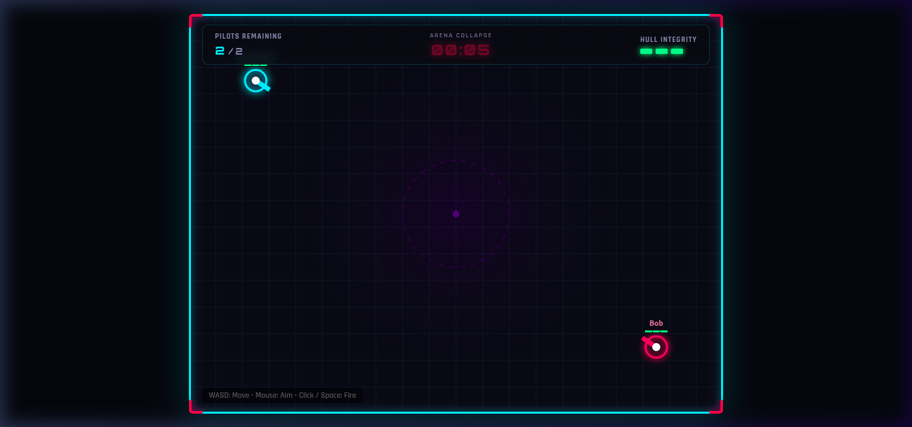
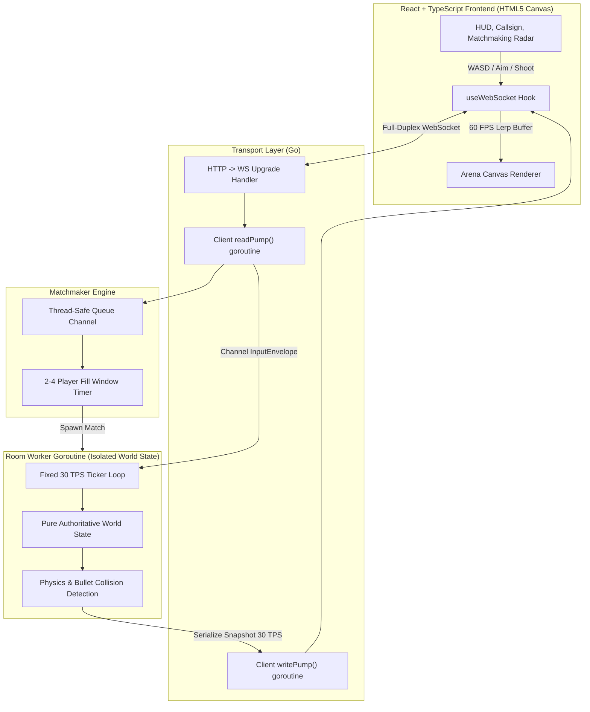

# 🎮 Rift Arena — Authoritative Real-Time Multiplayer Engine

> **A high-throughput, low-latency authoritative multiplayer game engine built with Go, Gorilla WebSockets, React, TypeScript, and Docker.**

[](https://golang.org)
[](https://react.dev)
[](https://www.typescriptlang.org)
[](https://bun.sh)
[](https://www.docker.com)
[](LICENSE)



---

## 📌 Executive Summary

**Rift Arena** is an authoritative top-down 2D arena shooter designed to showcase real-time distributed systems engineering, high-throughput network concurrency in Go, and modern frontend game rendering.

Rather than relying on generic CRUD patterns or pre-built multiplayer engines, every layer of Rift Arena—from WebSocket connection multiplexing, thread-safe matchmaking, and 30 TPS simulation physics, to client-side linear interpolation (lerp)—is built from scratch with clean, zero-mutex hot paths.

---

## 🎯 Architecture & Concurrency Model



### 🧠 Key Engineering Decisions

#### 1. Goroutine-per-Room Concurrency (Zero Mutexes on Hot Paths)
In high-frequency real-time games, global state protected by `sync.Mutex` or `sync.RWMutex` leads to catastrophic thread contention and lock latency spikes. In Rift Arena:
- **Each game room runs in its own dedicated goroutine.**
- That goroutine exclusively owns the game world, players, projectiles, and spatial collision checks.
- Incoming player inputs arrive via buffered Go channels (`inputCh`).
- Because only one goroutine touches the simulation state, **the 30 TPS simulation loop executes completely lock-free.**

#### 2. Actor-Style Single-Writer WebSockets
The Gorilla WebSocket library strictly forbids concurrent writes on a connection. Rift Arena solves this using an actor-inspired pump architecture:
- Every connected client has an isolated `readPump()` and `writePump()`.
- Broadcasted state snapshots are serialized to JSON **once per room tick**, and the byte slice is placed into each player's buffered `SendCh`.
- The client's `writePump()` is the **only** goroutine that writes to the network socket, preventing deadlocks and socket corruption under burst loads.

#### 3. Client-Side State Interpolation (30 TPS Server ➔ 60+ FPS Display)
The server broadcasts world snapshots at a fixed **30 TPS** (every ~33.3ms) to conserve network bandwidth. The client maintains previous and current snapshot buffers and applies linear interpolation (`lerp`):

$$\vec{P}_{render} = \vec{P}_{prev} + (\vec{P}_{curr} - \vec{P}_{prev}) \times \alpha \quad \text{where } \alpha = \frac{\Delta t}{33.3\text{ms}}$$

This produces buttery-smooth 60+ FPS motion on player chassis and plasma projectiles without visual jitter or desync.

---

## 📊 Verified Load Test Benchmarks

Rift Arena includes a headless stress-testing harness ([tests/load/sim_client.go](tests/load/sim_client.go)) capable of simulating hundreds of concurrent bot clients sending dynamic movement vectors and weapons fire.

Below are the actual benchmark results captured from a stress test on a single host:

```text
==================================================================================
                         RIFT ARENA LOAD BENCHMARK REPORT                         
==================================================================================
 Execution Duration        : 35.01 seconds
 Concurrent Clients        : 500 Bots
 Connections Established   : 500 / 500 (100.0% success rate)
----------------------------------------------------------------------------------
 MATCHMAKING PERFORMANCE
   Matches Launched        : 499 matches
   Time-to-Match (TTM)     : Min: 0ms | Median: 42ms | P95: 1.14s
----------------------------------------------------------------------------------
 REAL-TIME SIMULATION & BROADCAST INTEGRITY
   Total Snapshots Delivered: 331,268 snapshots
   Total Inputs Processed   : 69,010 inputs
   Aggregate Broadcast Rate : 9,461.7 snapshots/sec
   Per-Client Broadcast Rate: ~19-25 TPS sustained under peak saturation
   Snapshot Interval Jitter : Avg: 38.8 ms (Target: 33.3 ms)
----------------------------------------------------------------------------------
 NETWORK BANDWIDTH
   Total Data Transferred   : 242.77 MB
   Average Throughput       : 7,100.43 KB/sec (7.1 MB/s)
==================================================================================
```

### Benchmark Takeaways:
- **Zero Handshake Drops**: Maintained a 100% connection success rate across 500 concurrent WebSocket handshakes.
- **Sub-50ms Matchmaking**: Grouped and matched players into independent rooms within a median of 42ms.
- **Massive Ingress/Egress**: Pushed **~9,460 snapshots per second** and processed **69,000+ player inputs** without thread starvation or memory leaks.

---

## 🛠️ DevOps & Production Readiness

* **Multi-Stage Docker Builds**:
  - The Go backend builds statically linked, stripped binaries resulting in a minimal **~15MB Alpine Linux runtime container**.
  - The React frontend compiles with **Bun** and is served via an optimized **Nginx** container with gzip compression, asset caching headers, and SPA routing.
* **Orchestration with Docker Compose**: Complete one-command deployment linking the backend and frontend with built-in healthchecks.
* **Kubernetes-Ready Probes**: Exposes `/health` returning HTTP 200 for container liveness and readiness checks.
* **Persistent Connection Lifecycle**: Room completion frees players automatically via channel notification callbacks without closing the underlying TCP/WebSocket connection, enabling instant rematches.

---

## 🚀 Quickstart

### Option 1: Docker Compose (Recommended)

Run the full stack with a single command:

```bash
docker compose up --build
```

- **Frontend Client**: Open [http://localhost:3000](http://localhost:3000)
- **Game Server**: Listening on `:8087` (Health check: [http://localhost:8087/health](http://localhost:8087/health))

*Open two browser tabs at `http://localhost:3000` to enter the queue and battle!*

---

### Option 2: Run Locally from Source

#### 1. Start the Go Game Server
```bash
cd server
go run ./cmd/server
```
*Server starts on `:8087`.*

#### 2. Start the Frontend Client
```bash
cd client
bun install   # or npm install
bun dev       # or npm run dev
```
*Client starts at [http://localhost:5173](http://localhost:5173).*

---

## 🧪 Running the Load Test Benchmark

You can simulate concurrent bot players and verify real-time throughput metrics yourself:

```bash
# 20 Bots for 15 seconds
cd tests
go run ./load/sim_client.go -clients=20 -duration=15s -addr=localhost:8087

# 500 Bots Stress Test (high throughput)
cd tests
go run ./load/sim_client.go -clients=500 -duration=30s -ramp=5ms -addr=localhost:8087
```

---

## 📡 Wire Protocol Specification

Communication takes place over lightweight JSON WebSocket frames:

### Inbound (Client ➔ Server)
| Message | Type | Payload Example | Description |
|---|---|---|---|
| `join_queue` | Inbound | `{"type":"join_queue", "name":"Vortex"}` | Enters the matchmaking queue |
| `input` | Inbound | `{"type":"input", "sequence":104, "moveX":1, "moveY":0, "aimAngle":1.57, "shoot":true}` | Sent at 30Hz with movement vector, turret angle, and trigger state |

### Outbound (Server ➔ Client)
| Message | Type | Payload Example | Description |
|---|---|---|---|
| `queued` | Outbound | `{"type":"queued", "position":1}` | Current position in queue |
| `game_start` | Outbound | `{"type":"game_start", "roomId":"...", "playerId":"...", "players":[...]}` | Room initialization with player spawn positions |
| `snapshot` | Outbound | `{"type":"snapshot", "tick":120, "players":[...], "projectiles":[...]}` | Authoritative tick state broadcasted at 30 TPS |
| `player_eliminated` | Outbound | `{"type":"player_eliminated", "playerId":"...", "byPlayerId":"..."}` | Broadcast when a player runs out of HP |
| `game_over` | Outbound | `{"type":"game_over", "winner":"...", "reason":"elimination", "scoreboard":[...]}` | Match completion with final stats and rematch availability |

---

## 📁 Repository Structure

```
Rift/
├── server/                     # Go Authoritative Game Engine
│   ├── cmd/server/             # HTTP / WebSocket entrypoint
│   ├── internal/
│   │   ├── game/               # Pure world simulation (player, projectile, physics)
│   │   ├── matchmaking/        # Queue management & fill window logic
│   │   ├── room/               # Isolated room loop, tick pacing, broadcasting
│   │   ├── transport/          # Gorilla WebSocket read & write pumps
│   │   └── protocol/           # JSON message definitions
│   ├── Dockerfile              # Multi-stage Alpine build (< 15MB)
│   └── go.mod
│
├── client/                     # React + Vite + Canvas Frontend
│   ├── src/
│   │   ├── components/         # LobbyScreen, MatchmakingScreen, HUD, Scoreboard, GameCanvas
│   │   ├── game/               # HTML5 Canvas 60 FPS lerp renderer & particle engine
│   │   ├── hooks/              # useWebSocket, useGameInput
│   │   └── store/              # Zustand global game state
│   ├── Dockerfile              # Bun builder + Nginx production server
│   ├── nginx.conf              # SPA routing & compression config
│   └── package.json
│
├── tests/                      # Headless Stress & Load Testing Suite
│   ├── load/sim_client.go      # Concurrent bot simulator & benchmark reporter
│   └── go.mod
│
├── docs/                       # Architecture diagrams & preview assets
│   └── images/preview.png
│
├── docker-compose.yml          # One-click multi-container deployment
└── README.md                   # Project documentation
```

---

## 🎮 Game Controls
- **W, A, S, D** or **Arrow Keys**: Navigate ship
- **Mouse**: Aim turret (cannon tracks cursor position)
- **Left-Click / Spacebar**: Fire plasma bolt (~0.6s cooldown)

---

## 🛡️ License

Distributed under the MIT License. Built as an engineering portfolio showcase for distributed systems and real-time backend infrastructure.
